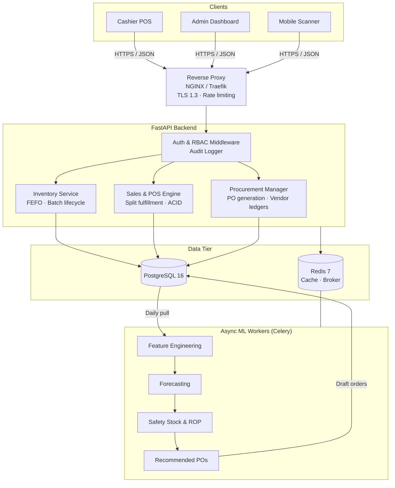

<div align="center">

# 🏥 Dr. Eman Ameen Pharmacy Management System

### Predictive Inventory · FEFO Batch Allocation · Automated Replenishment

A full-stack pharmacy management platform that combines real-time batch-level inventory control with machine-learning demand forecasting, so stock is dispensed in the right order, expires less often, and is reordered before it runs out.

[](https://www.python.org/)
[](https://fastapi.tiangolo.com/)
[](https://www.postgresql.org/)
[](https://redis.io/)
[](https://www.docker.com/)
[](#-predictive-inventory-engine)
[](LICENSE)

[Overview](#-overview) · [Features](#-features) · [Architecture](#-architecture) · [Quick Start](#-quick-start) · [API](#-api-reference) · [Testing](#-testing) · [Roadmap](#-roadmap)

</div>

---

## 📑 Table of Contents

- [Overview](#-overview)
- [Features](#-features)
- [Architecture](#-architecture)
- [Tech Stack](#-tech-stack)
- [Predictive Inventory Engine](#-predictive-inventory-engine)
- [FEFO Allocation](#-fefo-allocation)
- [Quick Start](#-quick-start)
- [Configuration](#-configuration)
- [API Reference](#-api-reference)
- [Project Structure](#-project-structure)
- [Testing](#-testing)
- [Security](#-security)
- [Roadmap](#-roadmap)
- [Contributing](#-contributing)
- [License](#-license)

---

## 📌 Overview

Pharmacies run on thin margins, strict regulation, and unpredictable demand. Before this system, **Dr. Eman Ameen Pharmacy** was dealing with three recurring problems:

| Problem | Impact |
| :--- | :--- |
| **Expired stock** | Older lots sat unnoticed while newer deliveries were dispensed first. |
| **Stockouts** | Chronic-care medicines and seasonal antibiotics ran out, causing lost sales and interrupted treatment. |
| **Manual reordering** | Purchasing relied on guesswork, tying up capital in slow-moving items. |

### The solution

An asynchronous **FastAPI** backend on a normalized **PostgreSQL** schema, paired with a **demand forecasting engine**. The system:

1. Allocates stock by **FEFO** (First Expired, First Out) on every sale.
2. Tracks expiry risk per batch and escalates warnings automatically.
3. Forecasts demand, computes **safety stock** and **reorder points**, and drafts purchase orders before shortages happen.

<!-- Add screenshots here once available:
<p align="center"></p>
-->

---

## 🌟 Features

### 🧠 Predictive inventory
- **Demand forecasting** with LightGBM and Prophet, capturing seasonality, category trends, and holiday effects.
- **Dynamic safety stock and reorder points** based on demand variability, lead-time variability, and a target service level.
- **Dead-stock and understock detection** to flag slow-moving SKUs and prevent capital from stagnating.

### 📦 Batch-level inventory
- **FEFO allocation** at point of sale, always drawing from the lot nearest expiry.
- **Tiered expiry monitoring:**

  | Status | Remaining shelf life | System behavior |
  | :--- | :--- | :--- |
  | 🟢 Normal | More than 6 months | No action |
  | 🟡 Approaching | 3 to 6 months | Alerts for return-to-vendor or promotion |
  | 🔴 Critical | Less than 3 months | Auto-dispense locked; pharmacist override required |

- **Concurrency-safe stock updates** using row-level locks (`SELECT ... FOR UPDATE`) to prevent overselling under simultaneous sales.

### 💳 POS and procurement
- **Split-batch fulfillment:** one line item can be served from several lots when no single lot has enough stock.
- **Purchase order lifecycle:** `DRAFT → ORDERED → RECEIVED → RECONCILED`.
- **Vendor performance tracking:** fulfillment accuracy, lead-time drift, and unit-cost variance.
- **Returns handling** with correct batch re-entry.

### 🔒 Security and compliance
- **Role-based access control:** `ADMIN`, `HEAD_PHARMACIST`, `STAFF_CASHIER`.
- **Append-only audit trail** recording user, timestamp, IP address, and before/after JSON diffs for every stock mutation.
- **Stateless JWT authentication** with Argon2id password hashing.
- **RFC 7807 Problem Details** for consistent, machine-readable error responses.

---

## 🏗️ Architecture



---

## 💻 Tech Stack

| Layer | Technology | Purpose |
| :--- | :--- | :--- |
| API | Python 3.11+, FastAPI | Async REST API |
| Database | PostgreSQL 16 | Relational store with ACID guarantees |
| ORM / Migrations | SQLAlchemy 2.0, Alembic | Typed queries and versioned schema changes |
| Cache / Broker | Redis 7 | Barcode lookup cache, Celery broker |
| Task queue | Celery | Scheduled training and forecasting jobs |
| Machine learning | LightGBM, Prophet, scikit-learn | Demand forecasting |
| Data processing | Pandas, NumPy | Lag, rolling, and seasonal features |
| Auth | PyJWT, Argon2id | Tokens and password hashing |
| Validation / Docs | Pydantic v2, OpenAPI | Strict schemas and interactive docs |
| Deployment | Docker, Docker Compose | Reproducible multi-service setup |

---

## 🔮 Predictive Inventory Engine

### Safety stock

Safety stock accounts for both demand variability and supplier lead-time variability:

$$
\text{Safety Stock} = Z \times \sqrt{\bar{L}\,\sigma_D^2 + \bar{D}^2\,\sigma_L^2}
$$

### Reorder point

$$
\text{ROP} = \bar{D} \times \bar{L} + \text{Safety Stock}
$$

| Symbol | Meaning |
| :--- | :--- |
| $Z$ | Service-level factor (1.96 targets roughly 97.5% availability) |
| $\bar{D}$, $\sigma_D$ | Mean and standard deviation of daily demand |
| $\bar{L}$, $\sigma_L$ | Mean and standard deviation of supplier lead time (days) |

### Pipeline

1. **Extract** daily sales history per SKU.
2. **Engineer features:** lags, rolling averages, seasonality, and calendar effects.
3. **Train and forecast** a 30-day horizon with confidence intervals.
4. **Compute** safety stock and reorder points from forecast and lead-time statistics.
5. **Recommend** purchase orders for SKUs below their reorder point.

---

## 🧮 FEFO Allocation

When a sale is processed, the system selects batches ordered by expiry date (earliest first), skipping locked, quarantined, or critical-status lots, and splits the quantity across lots as needed. Every selected row is locked for the duration of the transaction.

```sql
SELECT id, quantity_on_hand, expiry_date
FROM   batches
WHERE  medicine_id = :medicine_id
  AND  status = 'ACTIVE'
  AND  quantity_on_hand > 0
ORDER  BY expiry_date ASC
FOR UPDATE;
```

---

## 🚀 Quick Start

### Prerequisites

- [Docker](https://www.docker.com/products/docker-desktop/) 24.0+
- [Docker Compose](https://docs.docker.com/compose/) 2.20+
- *Optional, for running without Docker:* Python 3.11+, PostgreSQL 16, Redis 7

### 1. Clone

```bash
git clone https://github.com/your-username/dr-eman-ameen-pharmacy-system.git
cd dr-eman-ameen-pharmacy-system
```

### 2. Configure

```bash
cp .env.example .env
```

Generate a strong JWT secret and place it in `.env`:

```bash
python -c "import secrets; print(secrets.token_urlsafe(64))"
```

> ⚠️ **Never commit `.env`**, and change every default password before deploying anywhere beyond your local machine.

### 3. Launch

```bash
docker compose up --build -d
docker compose ps
```

### 4. Migrate and seed

```bash
docker compose exec api alembic upgrade head
docker compose exec api python scripts/seed_initial_data.py
```

### 5. Open

| Resource | URL |
| :--- | :--- |
| Swagger UI | http://localhost:8000/docs |
| ReDoc | http://localhost:8000/redoc |
| Health check | http://localhost:8000/api/v1/health |

---

## ⚙️ Configuration

| Variable | Description | Example |
| :--- | :--- | :--- |
| `APP_NAME` | Application display name | `Dr. Eman Ameen Pharmacy ERP` |
| `APP_ENV` | `development`, `staging`, or `production` | `development` |
| `DEBUG` | Enable debug mode (**must be `False` in production**) | `True` |
| `SECRET_KEY` | JWT signing secret | *(generated)* |
| `ALGORITHM` | JWT signing algorithm | `HS256` |
| `ACCESS_TOKEN_EXPIRE_MINUTES` | Token lifetime | `480` |
| `POSTGRES_USER` / `POSTGRES_PASSWORD` / `POSTGRES_DB` | Database credentials | see `.env.example` |
| `POSTGRES_HOST` / `POSTGRES_PORT` | Database location | `postgres` / `5432` |
| `DATABASE_URL` | Async SQLAlchemy connection string | `postgresql+asyncpg://...` |
| `REDIS_URL` | Redis connection string | `redis://redis:6379/0` |
| `MODEL_ARTIFACT_DIR` | Where trained models are stored | `/app/ml_engine/artifacts` |
| `FORECAST_HORIZON_DAYS` | Forecast window | `30` |
| `DEFAULT_SERVICE_LEVEL_Z` | Z-score for safety stock | `1.96` |

---

## 📡 API Reference

Full interactive documentation is available at `/docs`. Core endpoints:

### Inventory (`/api/v1/inventory`)

| Method | Endpoint | Description | Min. role |
| :--- | :--- | :--- | :--- |
| `GET` | `/medicines` | Catalog with stock levels and batch summaries | Cashier |
| `POST` | `/batches` | Ingest a batch with expiry and cost | Pharmacist |
| `GET` | `/expiries/critical` | Batches expiring within 90 days | Pharmacist |
| `PATCH` | `/batches/{id}/lock` | Lock or quarantine a batch | Pharmacist |

### Sales (`/api/v1/sales`)

| Method | Endpoint | Description | Min. role |
| :--- | :--- | :--- | :--- |
| `POST` | `/checkout` | Process an order with FEFO auto-allocation | Cashier |
| `GET` | `/transactions/{id}` | Full order breakdown with batch records | Cashier |
| `POST` | `/returns` | Process a return with batch re-entry | Pharmacist |

### Forecasting (`/api/v1/forecast`)

| Method | Endpoint | Description | Min. role |
| :--- | :--- | :--- | :--- |
| `POST` | `/train` | Trigger a training run on sales history | Admin |
| `GET` | `/{medicine_id}` | 30-day demand forecast with confidence intervals | Pharmacist |
| `GET` | `/replenishment-orders` | Recommended purchase orders | Pharmacist |

<details>
<summary><b>Example: checkout request</b></summary>

```http
POST /api/v1/sales/checkout
Authorization: Bearer <token>
Content-Type: application/json

{
  "items": [
    { "medicine_id": 42, "quantity": 12 }
  ],
  "payment_method": "CASH"
}
```

If no single batch holds 12 units, the response lists each batch used and the quantity drawn from it.

</details>

---

## 🗂️ Project Structure

```text
.
├── app/
│   ├── api/v1/            # Route handlers (inventory, sales, forecast, auth)
│   ├── core/              # Config, security, dependencies
│   ├── models/            # SQLAlchemy models
│   ├── schemas/           # Pydantic schemas
│   └── services/          # Business logic (FEFO, procurement, audit)
├── ml_engine/             # Feature engineering, training, ROP solver
├── alembic/               # Database migrations
├── scripts/               # Seed and maintenance scripts
├── tests/                 # Unit and integration tests
├── docker-compose.yml
└── .env.example
```

> Adjust this tree to match the actual repository layout.

---

## 🧪 Testing

```bash
docker compose exec api pytest tests/ -v --cov=app --cov-report=term-missing
```

The suite uses `pytest` and `httpx` and covers:

- Endpoint integration (auth, RBAC, validation)
- FEFO ordering and split-batch allocation
- Concurrent checkout behavior under row-level locking
- Safety stock and reorder point calculations

---

## 🔐 Security

- Passwords hashed with **Argon2id**; tokens are signed JWTs with configurable expiry.
- Every route is protected by role checks; stock mutations are written to the audit log.
- TLS termination and rate limiting are handled at the reverse proxy.
- For production: rotate `SECRET_KEY`, disable `DEBUG`, restrict database and Redis to the internal network, and store secrets in a secrets manager rather than a plain `.env` file.

To report a vulnerability, please email the maintainers privately instead of opening a public issue.

---

## 🛣️ Roadmap

- [ ] Barcode / GS1 DataMatrix scanning support
- [ ] Supplier e-ordering integration
- [ ] Forecast accuracy dashboard (MAPE / WAPE by category)
- [ ] Multi-branch inventory and inter-branch transfers
- [ ] Arabic / English UI localization
- [ ] Controlled-substance register and reporting

---

## 🤝 Contributing

Contributions are welcome.

1. Fork the repository and create a feature branch: `git checkout -b feature/your-feature`
2. Make your changes with tests.
3. Run the test suite and linters.
4. Open a pull request describing the change and its motivation.

---

## 👥 Credits

- **Architecture and engineering:** Ahmed Badawy
- **Domain partner:** Dr. Eman Ameen Pharmacy, for workflow validation and deployment testing

---

## 📄 License

Released under the [MIT License](LICENSE).

<div align="center">

<sub>Built to reduce waste, prevent stockouts, and keep patients supplied.</sub>

</div>
